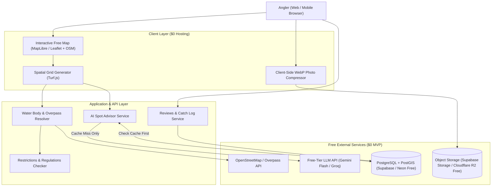

# 00 — System Architecture Overview ($0 MVP Stack)

> **Status**: `Proposed — Pending User Stack Confirmation`

---

## 1. High-Level Architecture Diagram

## 2. $0 Budget Engineering Principles
1. **Compute on the Edge/Client Where Possible**: Generating the coordinate grid (`A1..H8`) over a water body polygon using `Turf.js` costs $0 in client/serverless CPU.
2. **Cache-First AI**: Water body analyses are cached in PostgreSQL (`grid_analyses` table) keyed by `(water_body_id, fishing_type, target_species, access_mode, season)`.
3. **Aggressive Media Optimization**: Photos are compressed in the browser to `<200KB` WebP before touching cloud storage, allowing ~5,000 catch photos per 1GB of free storage.
