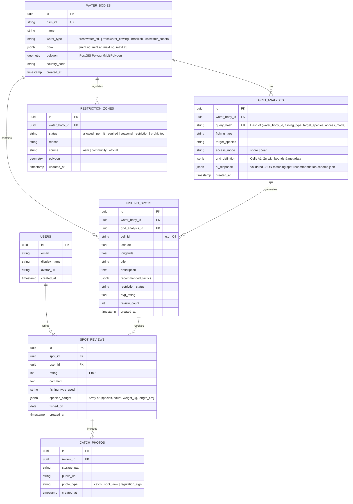

# Database Schema Specification (PostgreSQL + PostGIS)

> **Status**: `Draft — Pending DB Stack Confirmation`  
> **Target DB**: Free-tier PostgreSQL (Supabase / Neon) with PostGIS extension

---

## 1. Entity Relationship Diagram

## 2. Indexing & Performance Strategy ($0 Tier)
- `idx_water_bodies_osm_id`: Fast lookup when a user clicks an already-indexed OSM water body.
- `idx_grid_analyses_query_hash`: Instant `O(1)` cache hit for repeated AI queries on the same water body, fishing style, and target fish.
- `idx_fishing_spots_water_body`: Fast retrieval of all AI-suggested and community-reviewed spots on a selected water body.
