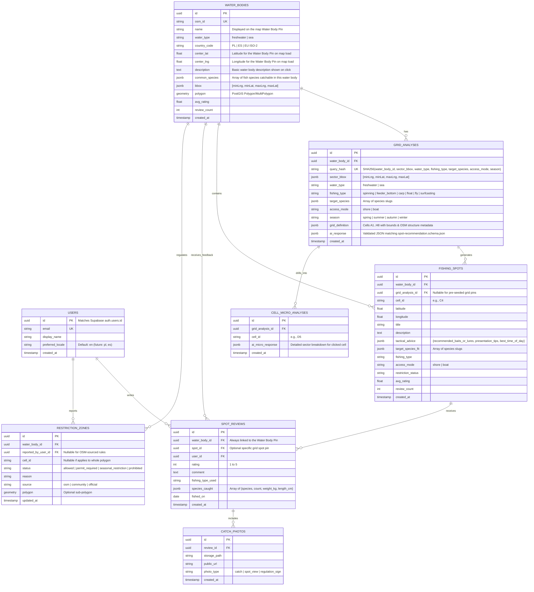

# Database Schema Specification (Supabase PostgreSQL + PostGIS + Drizzle ORM)

> **Status**: `Approved`  
> **Target DB**: Supabase Free Tier (PostgreSQL + PostGIS) managed via **Drizzle ORM** (`db/migrations/`)

---

## 1. Entity Relationship Diagram

## 2. Indexing & Performance Strategy ($0 Tier)
- `idx_water_bodies_center`: Fast bounding-box retrieval of named **Water Body Pins** (`center_lat`, `center_lng`, `name`) when the map loads or pans.
- `idx_water_bodies_osm_id`: Instant lookup for OSM water bodies.
- `idx_grid_analyses_query_hash`: `O(1)` cache hit for repeated AI grid queries (`0` LLM tokens spent).
- `idx_fishing_spots_water_body`: Fast retrieval of exact grid spot pins for **registered users**.
